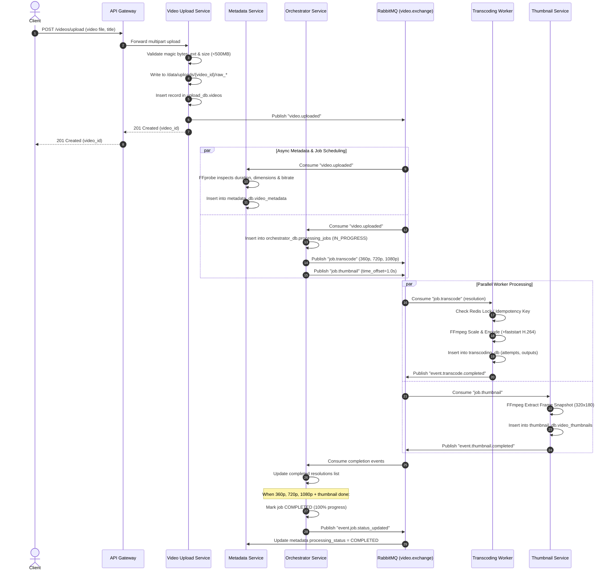
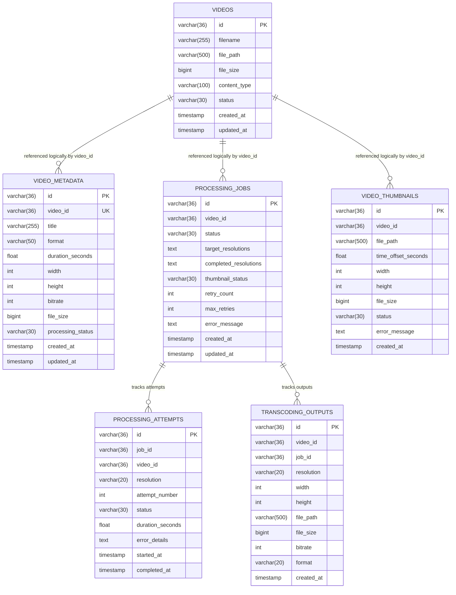

# Distributed Video Processing Platform - Architecture Specification

## 1. System Overview

The **Distributed Video Processing Platform** is a scalable, resilient, microservices-based system designed to handle video uploads, extract metadata, execute multi-resolution video transcoding (360p, 720p, 1080p), generate preview thumbnails, and serve video streams via HTTP 206 Partial Content.

The system is decoupled using **domain-driven microservice boundaries**, asynchronous messaging via **RabbitMQ**, caching and idempotency locks via **Redis**, service-owned schemas in **MySQL 8**, and an interactive dashboard built with **React and TypeScript**.

---

## 2. Microservice Architecture & Boundaries

```mermaid
graph TD
    User["Client / React Frontend (Port 3000)"]
    Gateway["API Gateway Service (Port 8000)"]

    subgraph Service Mesh
        Upload["Video Upload Service (Port 8001)"]
        Metadata["Video Metadata Service (Port 8002)"]
        Orchestrator["Transcoding Orchestrator (Port 8003)"]
        Worker["Transcoding Worker (Port 8004)"]
        Thumbnail["Thumbnail Service (Port 8005)"]
        Delivery["Media Delivery Service (Port 8006)"]
    end

    subgraph Messaging & Cache
        RabbitMQ["RabbitMQ Broker (video.exchange)"]
        DLQ["Dead Letter Queue (video.dlx)"]
        Redis["Redis Cache & Distributed Lock"]
    end

    subgraph Databases (Service-Owned)
        DB_Upload[(upload_db)]
        DB_Meta[(metadata_db)]
        DB_Orch[(orchestrator_db)]
        DB_Trans[(transcoding_db)]
        DB_Thumb[(thumbnail_db)]
    end

    subgraph Shared Storage
        Storage[("/data Volume: uploads, transcoded, thumbnails")]
    end

    User -->|HTTP / REST| Gateway
    Gateway -->|Forward: Upload| Upload
    Gateway -->|Forward: Metadata| Metadata
    Gateway -->|Forward: Trigger/Status| Orchestrator
    Gateway -->|Forward: Outputs| Delivery
    Gateway -->|Forward: Thumbnails| Thumbnail
    Gateway -->|Stream: HTTP 206| Delivery

    Upload --> DB_Upload
    Metadata --> DB_Meta
    Orchestrator --> DB_Orch
    Worker --> DB_Trans
    Thumbnail --> DB_Thumb

    Upload -->|Save Raw Video| Storage
    Worker -->|Read Raw / Write Transcoded| Storage
    Thumbnail -->|Read Raw / Write Thumbnails| Storage
    Delivery -->|Read Streams & Images| Storage

    Upload -->|Publish: video.uploaded| RabbitMQ
    RabbitMQ -->|Event: video.uploaded| Metadata
    RabbitMQ -->|Event: video.uploaded| Orchestrator

    Orchestrator -->|Publish: job.transcode| RabbitMQ
    Orchestrator -->|Publish: job.thumbnail| RabbitMQ

    RabbitMQ -->|Consume: job.transcode| Worker
    RabbitMQ -->|Consume: job.thumbnail| Thumbnail

    Worker -->|Lock & Dedup| Redis
    Worker -->|Publish: event.transcode.completed| RabbitMQ
    Worker -->|Publish: event.transcode.failed| RabbitMQ
    Thumbnail -->|Publish: event.thumbnail.completed| RabbitMQ

    RabbitMQ -->|Consume Completion Events| Orchestrator
    Orchestrator -->|Exceeded Retries -> DLQ| DLQ
```

---

## 3. Communication Patterns

### 3.1 Synchronous Communication (REST APIs)
- **Client to API Gateway**: All client interactions pass through `http://localhost:8000`. The gateway validates input, unifies error responses, and enforces CORS policies.
- **Gateway to Downstream Services**: High-speed internal HTTP requests forward queries for metadata, available outputs, and streaming chunks.
- **Video Playback & Seeking (HTTP 206 Partial Content)**:
  Client issues `Range: bytes=start-end` requests to `/media/videos/{video_id}/{resolution}`. The Media Delivery Service parses byte ranges and streams binary chunks directly from disk.

### 3.2 Asynchronous Communication (RabbitMQ Event-Driven)



---

## 4. Service-Owned Database Schemas

To maintain **strict service independence**, no service shares or accesses another service's database directly.



---

## 5. Reliability & Fault-Tolerance

### 5.1 Idempotency & Message Deduplication
When RabbitMQ delivers messages with at-least-once guarantees, workers can receive duplicate task messages:
1. **Database Check**: Before transcoding, `TranscodingWorker` queries `transcoding_outputs` for `(video_id, resolution)`. If a completed record exists, the message is acknowledged and re-emits a completion event without re-encoding.
2. **Distributed Redis Lock**: `SET lock:transcode:{video_id}:{resolution} 1 NX EX 600`. Only one worker can acquire the lock for a given resolution at a time. Concurrent duplicate messages are safely skipped.

### 5.2 Retry Policy and Dead Letter Queue (DLQ)
- Each transcoding job specifies `max_retries = 3`.
- When an individual attempt fails:
  1. The worker records status `FAILED` in `processing_attempts` with `error_details`.
  2. Emits `event.transcode.failed`.
  3. The Orchestrator intercepts the failure, increments `retry_count`, updates job status to `RETRYING`, and re-enqueues the transcode task with backoff.
- If `retry_count >= max_retries`:
  1. Orchestrator marks job status as `FAILED`.
  2. The failed task is moved to `video.dlx` (Dead Letter Exchange) and stored in `transcoding.dlq` for operator inspection.
  3. The error details are displayed in the dashboard with a manual **Retry** trigger button.

### 5.3 Video Upload Validation & Security
1. **Extension Whitelisting**: Restricted to `.mp4`, `.mov`, `.avi`, `.mkv`, `.webm`.
2. **Magic Byte Signature Inspection**: Analyzes file header bytes (`ftyp` for MP4, `RIFF` for AVI, `\x1a\x45\xdf\xa3` for WebM/MKV) preventing disguised malicious files.
3. **Size Limit Enforcement**: 500MB maximum upload limit; uploads exceeding this are rejected with `HTTP 413 Payload Too Large`.
4. **Streaming Writes**: Files are written in 1MB chunks to prevent memory spikes on large files.
